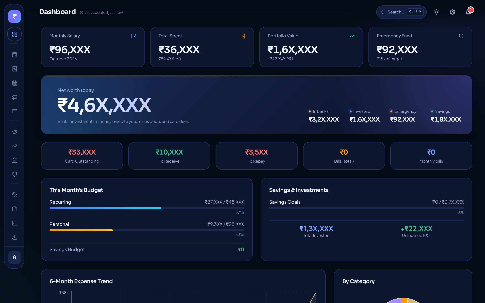

<div align="center">

# WYLTH

**Grow quietly.**

A personal finance app for Windows that tracks your whole financial life and keeps every byte on your own PC.
No account. No internet. No cloud.



</div>

> Screenshots use dummy data, and every amount is masked (only the first two digits are visible).

## Why WYLTH

Most money apps want your data, your email and your permissions, and their balances rarely match your bank.
WYLTH is built around two ideas:

- **Every rupee has a ledger entry.** Each bank balance is explained line by line, so the numbers always add up.
- **Your data never leaves your PC.** There is no server, no sign-up and no analytics.

## Features

- **Bank accounts:** a full ledger and downloadable statement for every account
- **Credit cards:** several cards, statement cycles, due-date alerts, a spending breakdown and a pay-bill button
- **Salary split:** divides income into needs, wants and investing
- **Expenses and monthly spending:** daily tracking with category and month views, paid from a chosen account
- **Recurring and bills:** rent, utilities and subscriptions, settled straight from the bank
- **Investments:** stocks, SIPs, FDs, bonds, PPF, NPS, metals and more, with a sell flow and an *estimated* capital-gains tax figure
- **Emergency fund and savings goals:** tied to real bank accounts so the values always match
- **Lending and debts:** per-person balances that net out
- **Notes:** dated notes for your money ideas
- **Analytics:** income vs spending, trends and allocation
- **Reminders** for bills and card dues
- **Export to Excel, backup and restore**
- **Password lock,** light and dark themes, `Ctrl + K` quick search, and a trash bin with restore

## Screenshots

| Credit cards | Investments |
|---|---|
|  |  |
| **Bank statement** | **Emergency fund** |
|  |  |
| **Notes** | **Light theme** |
|  |  |

## Privacy

WYLTH stores everything in a local SQLite database in your Windows user folder. The app has no online features and sends nothing anywhere.
Exports and backups are files you create yourself, so they stay on your machine unless you share them.

## Run it

You need [Node.js](https://nodejs.org) (LTS) on Windows.

```bash
# first time
npm install

# run in development
npm run dev        # or double-click start.bat

# run the tests
npm test
```

## Build the installer

Double-click `build.bat`, or run:

```bash
npm run dist
```

The installer is created in the `release` folder as `WYLTH Setup <version>.exe`.

## Notes and disclaimer

- The capital-gains figures are **planning estimates only** (Indian equity rules, FIFO lots). They are not tax advice, and surcharge is not included.
- Back up your data regularly from the Export screen.

## Feedback

Found a bug or have an idea? Open an issue. If WYLTH helps you, a star on the repo and some feedback mean a lot.
This project is **source-available, not open source**: you are welcome to use it and read the code, but pull requests are not accepted.

## License

Free to use for personal, non-commercial purposes. **No modification or redistribution.** See [LICENSE](LICENSE) for the full terms.
